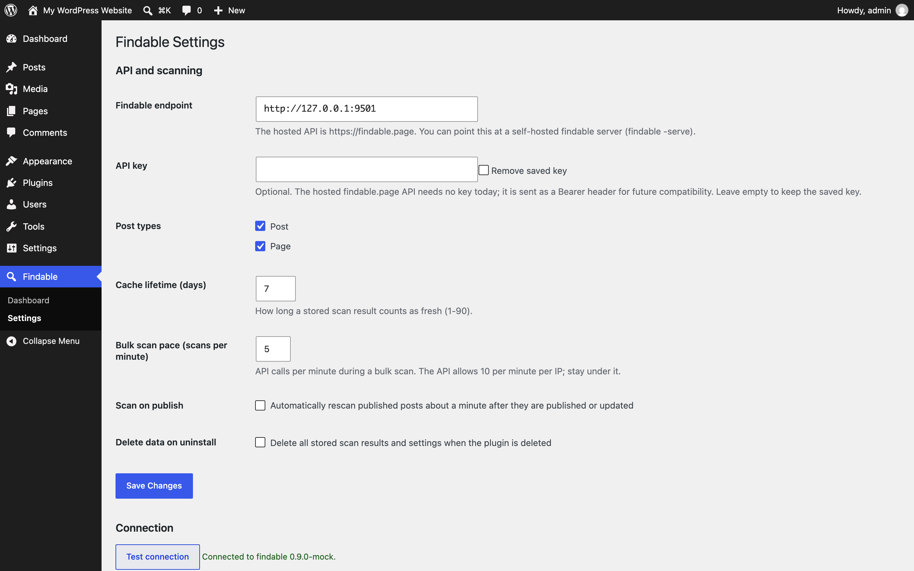
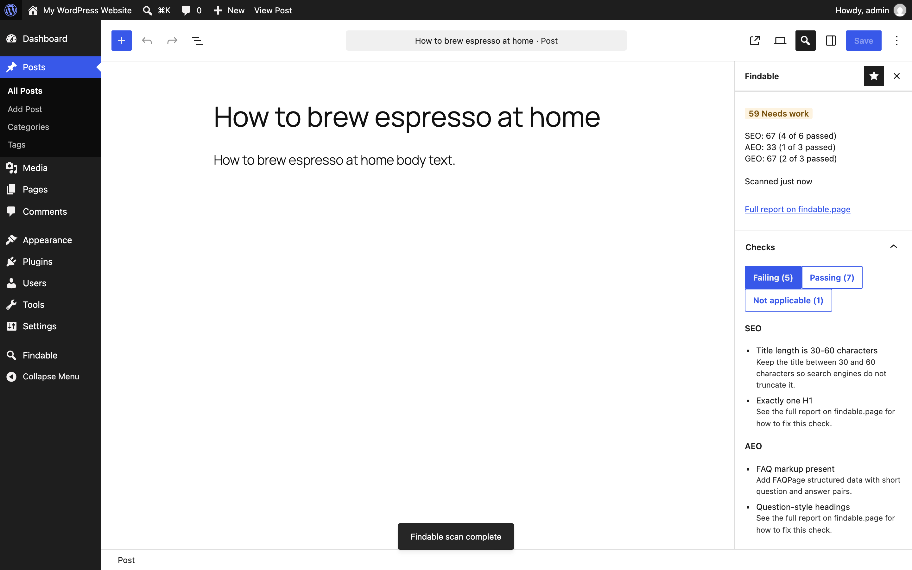
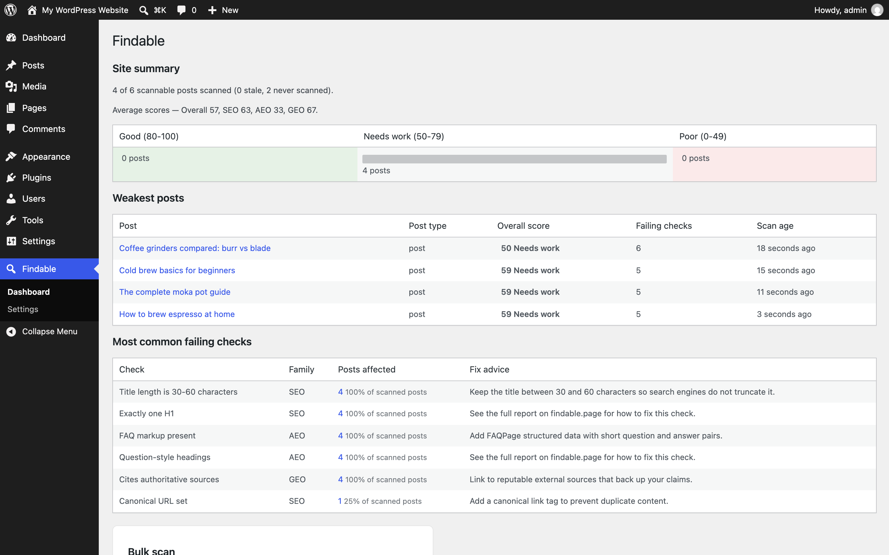
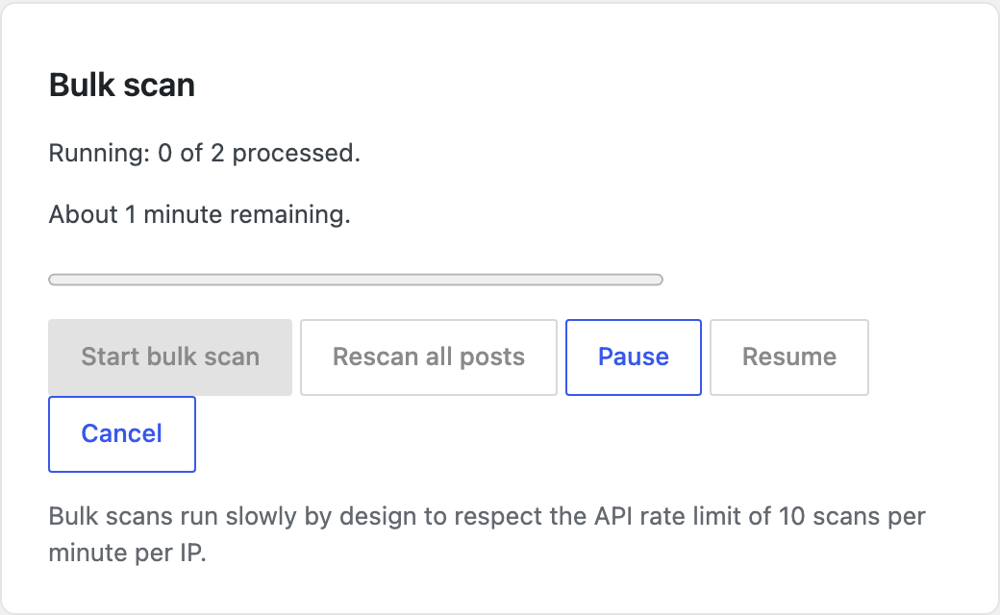
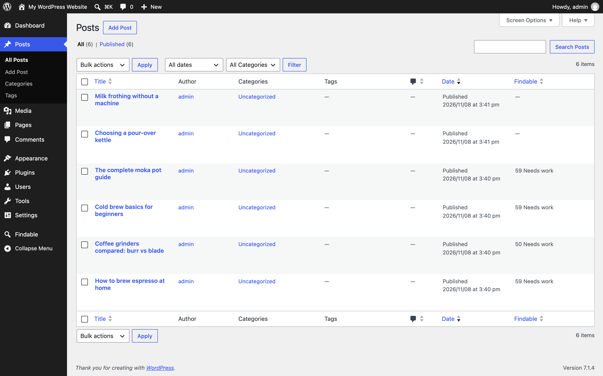

# Findable WP

WordPress plugin (slug `findable`) that scores posts and pages for SEO, AEO and GEO findability through the [Findable API](https://findable.page). Source for the [findable](https://github.com/findable-page/findable) and [findable-page](https://github.com/findable-page/findable-page) projects.

## What it does

- Block editor sidebar + classic meta box: overall/SEO/AEO/GEO scores, per-check breakdown, fix advice, optional keyphrase.
- Findable dashboard: averages, band distribution, weakest posts, most common failing checks, bulk scan panel.
- WP-Cron bulk scan paced under the API's 10 scans/minute/IP limit, with 429 backoff.
- Everything translatable; localized check names/fix advice for de/es/ru/tr from the API.

## Screenshots

| | |
|---|---|
|  Settings |  Editor score sidebar |
|  Site dashboard |  Bulk scan |
|  Posts list column | |

Regenerate with `npm run screenshots` (real WordPress via Playground + mock API); writes `.wordpress-org/screenshot-N.png` and `docs/screenshots/`.

## Local setup

```bash
composer install          # dev tooling: PHPCS + PHPUnit deps
npm install               # @wordpress/scripts
npx wp-env start          # WordPress 6.5 with the plugin active (see .wp-env.json)
```

The plugin's REST namespace is `findable/v1`; all outbound HTTP goes through `Findable\Api_Client` only.

## Tests and lint

```bash
bash bin/install-wp-tests.sh wordpress_test root root 127.0.0.1:3306 6.5   # once; needs MySQL
composer test          # PHPUnit: single site + constants suite
composer test:coverage # + multisite, pcov, fails under 95% line coverage
composer lint          # PHPCS (WordPress + PHPCompatibilityWP)
composer fix           # phpcbf
npm run lint:js        # ESLint (forbids dangerouslySetInnerHTML)
npm run test:unit      # Jest (editor sidebar + assets/admin.js)
npm run test:unit:coverage  # Jest, fails under 95% line coverage
npm run test:e2e       # Playwright against WordPress Playground + mock Findable API
npm run build          # build/ from src/
```

Tests never touch the network: the bootstrap turns any unstubbed `wp_remote_*` call into a failure.

## Regenerating assets

```bash
npm run make-pot                      # languages/findable.pot (PHC + JS)
php bin/sync-fix-advice.php ../findable-page   # bundled English advice from the web bundle
```

Commit both results; CI verifies the POT is fresh and CI builds never fetch them live.

## Release

Tagging `v*` triggers `.github/workflows/release.yml`: verifies the tag matches the plugin version, builds `build/`, zips with `.distignore` rules, attaches the zip to the GitHub release and (when `SVN_USERNAME`/`SVN_PASSWORD` secrets exist) deploys to WordPress.org.

## License

GPLv2 or later. The bundled English fix advice is derived from the findable-page web UI (MIT).
